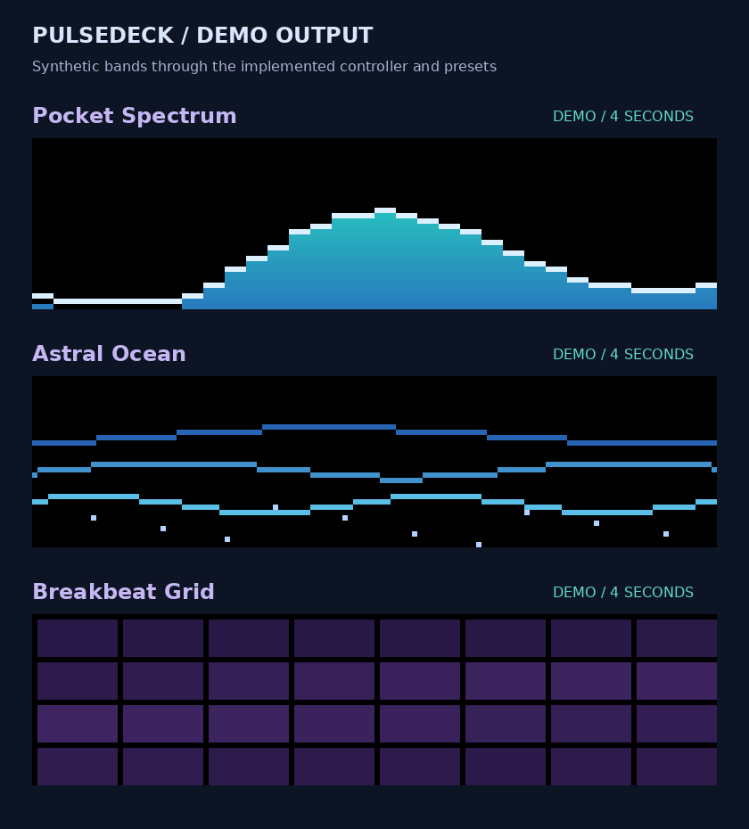

# 🎛️ PulseDeck

Give your Claude Code terminal a little rhythm. Watch your music rise into neon bars, roll through a starry ocean, or light up a retro grid while you work. ✨



## Get the good vibes going

PulseDeck runs in **Claude Code 2.1.293 or later**, in your terminal. Live audio supports **Apple Silicon Macs running macOS 14.2 or later**. The audio helper is included—no separate CAVA installation or build commands.

1. In Claude Code, add the marketplace:

   ```text
   /plugin marketplace add justjammin/pulsedeck
   ```

2. Install PulseDeck:

   ```text
   /plugin install pulsedeck@pulsedeck
   ```

   Follow Claude Code’s activation or reload instruction.

3. Open your decks:

   ```text
   /pulsedeck
   ```

4. Play some music and press **Start**. If macOS asks, allow system audio recording for your terminal app. This lets PulseDeck follow audio playing on your computer.

## Pick your vibe

| Preset | Look |
| --- | --- |
| **Spectrum** | Colorful equalizer bars with falling peaks |
| **Ocean** | Rolling waves and floating stars |
| **Grid** | Drum hits light up a neon grid |

Switch presets while your music keeps playing. **Expand** makes room for the show; **Compact** tucks it above your prompt. **Reduce motion** slows the animation. **Stop** ends capture. **Demo** uses synthetic data so you can try the looks without playing music.

PulseDeck opens stopped and remembers your visual preferences. Closing the expanded pane returns the display to its compact view.

## Handy controls

```text
/pulsedeck start
/pulsedeck stop
/pulsedeck demo
/pulsedeck preset ocean
/pulsedeck motion reduced
/pulsedeck reset
```

## Need a hand?

- **Permission missing:** open macOS System Settings → Privacy & Security → Screen & System Audio Recording, allow system audio recording for your terminal app, then press Start again. Some macOS versions list System Audio Recording Only separately.
- **Command missing:** follow Claude Code’s reload instruction, type `/` and select PulseDeck. Check `/plugin` → Errors for installation errors.
- **Quiet visuals:** play audio through your Mac’s output device. PulseDeck never falls back to your microphone.
- **Using Desktop:** visual animation runs in the terminal; Desktop displays text status.

## Behind the decks

PulseDeck works locally, with no model calls, network requests, telemetry, or audio recordings. It keeps the latest spectrum instead of storing your music. CAVA, FFTW, and iniparser are bundled with their licenses and source materials.

PulseDeck is licensed under **GPL-3.0-or-later**. For contributors: [development guide](docs/DEVELOPMENT.md), [validation evidence](docs/VALIDATION.md), and [audio build recipe](scripts/build-cava.sh).
