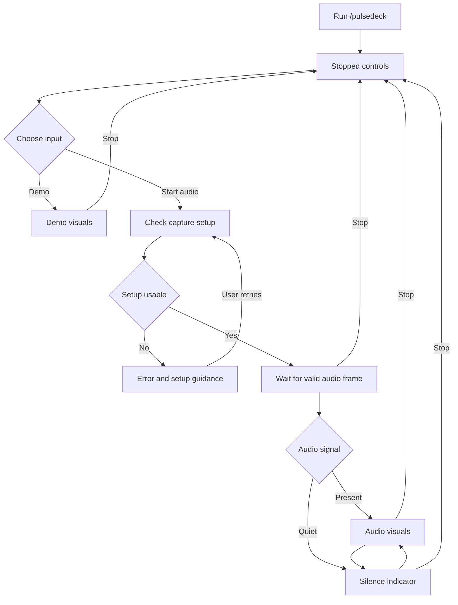

# PulseDeck application flow

## Interaction model

PulseDeck lives in a band above the Claude Code prompt and an optional expanded pane. The controls operate through mod commands and callbacks, not model turns. Audio capture is stopped at session start. Opening the controls does not implicitly authorize capture.

## First use and recovery flow

The controller also permits Stop during setup. An unexpected helper exit moves any audio state to Error and disposes the active source. Closing the expanded pane returns to compact mode; Stop is the explicit action that ends capture. The distinction is visible in controls and help.

## Screen inventory

| View | Required content | Primary actions |
| --- | --- | --- |
| Stopped | Preset name, capture is stopped, source preference | Start, Demo, Setup |
| Checking | Checking selected source, cancellable progress | Stop |
| Waiting | Source name, waiting for valid frame | Stop, Setup |
| Audio | Selected preset, live spectrum, Audio label | Stop, preset, expand or compact |
| Silence | Quiet source indicator and reduced animation | Stop, source, expand or compact |
| Demo | Persistent Demo label and synthetic visuals | Stop, Start audio, preset |
| Error | Short observed failure and relevant setup action | Retry, Demo, Setup, Stop |
| Expanded | Larger drawing and visible controls | Compact, Stop, preset, motion |

Keep source, mode, and Stop visible in both layouts. On narrow terminals, the pane may be placed above the prompt by the host. Text fallback still communicates status if graphics cannot be displayed.

## User-facing command contract

| Command | Result |
| --- | --- |
| /pulsedeck | Open current controls without changing capture |
| /pulsedeck start | Check and start the selected real audio source |
| /pulsedeck stop | Dispose source and render timer; show Stopped |
| /pulsedeck demo | Stop any real source, then start labeled synthetic visuals |
| /pulsedeck preset spectrum | Select Pocket Spectrum |
| /pulsedeck preset ocean | Select Astral Ocean |
| /pulsedeck preset grid | Select Breakbeat Grid |
| /pulsedeck expand | Open the expanded pane |
| /pulsedeck compact | Close expanded layout and retain compact view |
| /pulsedeck motion reduced | Disable flashes and moving particles; draw at two FPS |
| /pulsedeck source | Show source selection and setup guidance |
| /pulsedeck status | Show observed mode, backend, limits, and diagnostic counters |
| /pulsedeck reset | Stop and reset PulseDeck preferences only |

Exact registration syntax and namespacing are confirmed with the host during the first integration ticket. Unknown arguments show usage and do not change state. All controls are available while Claude works where the host supports immediate mod commands.

## Source switching

Selecting another source never creates a second simultaneous helper. The controller first stops the current source, clears its frame, then validates the new source and starts it after an explicit Start. A preference change while stopped does not start capture. A generation counter prevents late data from the retired source appearing in the new view.

## Failures and user wording

- Missing bundled executable: The PulseDeck audio component is missing or damaged. Reinstall the supported release or choose Demo. A supported release supplies CAVA without a separate package-manager step.
- Backend unavailable: The selected capture backend could not start. Check the CAVA build and source configuration.
- Permission denied: Show the observed permission error and a relevant OS action; do not diagnose permission failure from silence alone.
- No valid frames: The source is running but has not produced valid spectrum data. Check the selected monitor source.
- Unexpected exit: Audio capture stopped. Retry starts a new capture process only when the user requests it.

## Motion and focus behavior

Reduced motion is remembered and applies to every preset. Breakbeat Grid uses modest brightness changes rather than a full-screen flash. Pane opening from a background event does not seize focus. Source, mode, and error labels remain understandable without color. Settings controls explain product choices without exposing parsing or host API implementation details.

## Lifecycle exit paths

Stop, source replacement, Demo selection, reset, plugin unload, and session end all use the same idempotent disposal operation. No spectrum data is saved. A session restart restores visual preferences in Stopped state. The host adapter must verify which unload and close events are actually available in the target version.

## Approved scope update: one plugin install includes CAVA
The user clarified that PulseDeck must provide CAVA as part of plugin installation, with no separate Homebrew, apt, compiler, or configuration step on supported platforms. The release artifact must include a tested platform-specific CAVA executable and required private runtime libraries, with pinned provenance and notices. Default output-monitor selection is automatic only for a verified bundled build. OS audio permission prompts may remain necessary; no microphone fallback is allowed.

The current development preview may lack these payloads and must say so. Release packaging must fail when audited payloads are missing. Clean-machine install -> open -> Start is a release acceptance test. Claude skips normal package lifecycle scripts, so postinstall is not the dependency delivery mechanism. Native streaming integration remains separately gated on verified host contracts.
