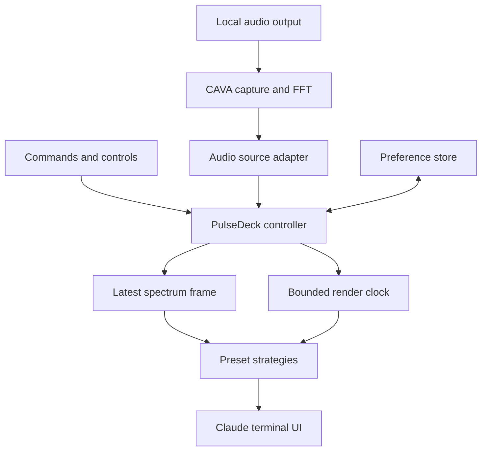

# PulseDeck high level design

## Framework and design decision

This design follows Hello Interview's delivery order: requirements, core entities, system interface, data flow, high-level architecture, and deep dives. It applies that order to a local terminal mod, where process ownership, frame flow, and resource bounds are the important scaling decisions. The product does not need a distributed backend. [S06]

## Requirements

The three prioritized functional requirements are real-audio visualization, live control of three presets and two layouts, and clear stop/recovery behavior. The prioritized system qualities are bounded retained data, responsive rendering, predictable cleanup, local-only processing, and compatibility that is proven on each advertised host.

Capacity calculations are included where they affect design: a thirty-two-band frame fits within 129 bytes, the stream is about 2.6 KB per second at twenty FPS, and two capped RGBA grids require 49,152 bytes. These sizes support a single latest-frame slot, bounded transport parsing, and fixed render buffers. They do not support an estimate of total host RSS by themselves.

## Core entities

| Entity | Meaning | Lifetime |
| --- | --- | --- |
| Visualizer session | Controller, source ownership, state, generation | One installed mod instance |
| Spectrum frame | Thirty-two normalized amplitudes and receipt time | Replaced by the next valid frame |
| Visual state | Smoothed bands, peaks, bounded particles and grid intensity | Until Stop or reset |
| Preferences | Preset, layout, motion, and source configuration | Persisted under a versioned plugin key |
| Source handle | Owned capture process or demo producer and disposal function | One start/stop generation |

## System interface

The external contract is local commands and controls, described in the app-flow document. Internally, the controller depends on an AudioSource, Renderer, Clock, PreferencesStore, and HostUI boundary. Data passes in memory through callbacks and bounded buffers. No REST endpoints are introduced merely to resemble a server application.

AudioSource emits complete validated spectrum frames or observed source events. The Renderer draws from a view snapshot and current visual state. The HostUI adapter translates that result into Claude's supported terminal elements and requests invalidation at the permitted rate. Persistence saves preferences only.

## Data flow

1. A user selects Start in the mod interface.
2. The controller validates the source and allocates a new generation.
3. CAVA captures local audio and emits ASCII spectrum frames.
4. The source adapter validates and normalizes frames into reusable arrays.
5. The controller replaces its latest-frame slot; old frames are not queued.
6. A render tick reads that slot, advances bounded visual state, and draws the selected preset.
7. HostUI displays the compact band or expanded pane.
8. Stop invalidates callbacks, disposes the source and timer, and clears active data.

## Architecture

CAVA is the only extra process in real-audio mode. Demo mode replaces CAVA with a bounded synthetic source and uses the same controller and render path. There is no second host browser, network stream, retained transcript, or background agent.

## Deep dive on backpressure

Rendering has no obligation to display every capture frame. When input is faster than display, overwrite the latest-frame slot. This sacrifices intermediate animation frames while preserving responsiveness and bounded memory. Continue consuming helper stdout even when the pane is compact; never accumulate an unread capture log. Parser capacity and diagnostic capacity are fixed independently of session length.

## Deep dive on lifecycle races

Async setup, process events, and user controls can arrive in different orders. A generation identifier tags every source callback. Start and Stop update ownership centrally. Events from an old generation are ignored, and only the current handle can be disposed. Source replacement is serialized behind disposal, preventing duplicate helpers and stale audio appearing after Stop.

## Deep dive on performance

Use thirty-two bands, reusable typed arrays, precomputed colors, fixed particle capacity, and bounded render dimensions. Compact drawing runs at ten FPS; expanded drawing targets twenty; silence and reduced motion draw at two. Claude's documented redraw throttling remains the upper bound. [S02]

If measured retained heap or CPU misses its target, first reduce per-frame object creation, particle activity, or dimensions. Lower the helper frame rate before introducing another runtime. RSS measurements include CAVA and a host baseline; a parser-only benchmark is insufficient for the complete product.

## Deep dive on platform compatibility

CAVA abstracts many audio backends, but installation and source routing remain platform-specific. macOS system capture depends on OS version and build support. Linux should select a monitor of PipeWire or PulseAudio output. The source never silently falls back to a microphone. Desktop rendering requires a different adapter because terminal Raster support is not universal. Windows and Desktop are compatibility work after the terminal release, not implicit guarantees. [S02, S04]

## Deep dive on persistence and failure containment

Store only a small versioned settings object. Runtime data is ephemeral. Bad settings revert to safe values. Parsing failures increment bounded counters and drop bad frames. Helper exit produces a visible Error state. Retry requires a user action, preventing background crash loops. CAVA setup failures leave Claude's normal UI and work unaffected.

## Architecture decisions

ADR 01 selects CAVA over a custom FFT engine to avoid owning several capture backends in the first release. ADR 02 selects latest-frame overwrite over a frame queue. ADR 03 selects interchangeable preset strategies with shared source ownership. ADR 04 chooses terminal-first UI and defers unsupported surfaces. ADR 05 persists preferences without auto-start capture.

These are proposed decisions for the design review. The detailed interfaces and state transition rules appear in the low-level design; the review spec records their user-visible consequences.
