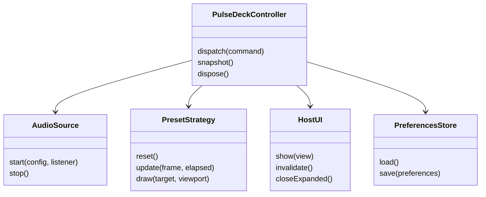

# PulseDeck low level design

## Design decision

Keep lifecycle decisions in one controller, isolate host and audio integration behind small adapters, and make visual algorithms interchangeable. Refactoring Guru supplies the vocabulary for Strategy, Adapter, and State. This design applies those patterns only where they reduce coupling or clarify behavior. [S07-S09]

## Pattern selection

| Pattern | PulseDeck application | Benefit | Cost avoided |
| --- | --- | --- | --- |
| Strategy | Pocket Spectrum, Astral Ocean, Breakbeat Grid implement one preset contract | Switch visual behavior without replacing the source | A large preset switch inside capture logic |
| Adapter | CAVA source and Claude HostUI translate external interfaces | Core controller stays independent of transport and terminal elements | Host API calls scattered through algorithms |
| State | Explicit lifecycle phases and allowed transitions | Stop and recovery behavior can be checked centrally | Several booleans representing contradictory modes |

State is represented by a small discriminated state model and transition function. It does not require one class allocation per lifecycle transition. Observer-style callbacks are used for source events, but the first version does not introduce an event bus or subscriber graph.

## Module responsibilities

| Module | Owns | Must not own |
| --- | --- | --- |
| PulseDeckController | Phase, source kind, generation, resource lifetime, commands | Capture backend implementation or terminal formatting |
| CavaAudioSource | Validated config, owned process, parser, bounded diagnostics | Preset, UI focus, or preference policy |
| DemoAudioSource | Deterministic bounded synthetic frame generation | Real audio process or persistent recording |
| PresetStrategy | Visual algorithm and bounded preset state | Process creation, networking, or global timers |
| ClaudeHostUI | Host commands, render sites, element conversion, invalidation | Audio interpretation or controller state decisions |
| PreferencesStore | Validation, versioned save/load/reset | Auto-start authorization or audio frames |
| ClockPort | Monotonic time, cancellable scheduling | Product transitions |

## Interface model

These method names describe intended boundaries; generated Claude types define the actual host adapter syntax. The controller's snapshot is the public behavioral testing seam.

## State and event model

Phases are Stopped, Checking, Waiting, Active, Silence, and Error. Source kind is None, Audio, or Demo. Demo uses Active with a permanent Demo label and its own source kind. Layout and motion are preferences independent of phase.

| Current phase | Event | Next phase | Owned-resource effect |
| --- | --- | --- | --- |
| Stopped or Error | Start audio | Checking | Allocate generation; validate source |
| Checking | Source starts | Waiting | Attach one source handle |
| Waiting, Active, Silence | Valid audible frame | Active | Replace latest frame |
| Waiting, Active, Silence | Valid quiet frame | Silence | Retain source; reduce render rate |
| Any audio phase | Current source exits | Error | Dispose current generation |
| Any | Stop | Stopped | Invalidate callbacks and dispose idempotently |
| Any | Demo | Active with Demo | Dispose real source, then start demo |
| Active or Silence | Preset change | Same phase | Reset preset state; retain source |
| Any | Expanded pane closes | Same phase | Use compact layout; capture continues |
| Any | Reset | Stopped | Dispose, clear plugin preferences, restore defaults |

Late callbacks from retired generations have no transition. Repeated Start while Checking, Waiting, Active, or Silence is an idempotent operation. A source-setting change stops capture and requires a subsequent explicit Start. Concurrent controls are serialized through the controller; they do not create competing startup tasks.

## Capture and parser details

The adapter starts a CAVA command using an argument list and a temporary plugin-owned configuration. The stream contract is fixed at thirty-two ASCII integer bars, inclusive range 0-255, semicolon separators, and newline frames. Handle CRLF by stripping one carriage return. Accept a trailing semicolon; reject missing bars, extra nonempty fields, non-integers, negatives, and out-of-range values.

A frame under construction has a hard capacity. When it overflows, discard bytes until the next newline. Do not grow a string indefinitely while waiting for a separator. Chunk boundaries may split numbers, delimiters, and newlines. Each completed valid frame overwrites the latest destination array. The parser never retains references to large original chunk strings after ingestion.

## Rendering algorithms

Pocket Spectrum applies time-based smoothing to thirty-two band values and falls peak markers at a time-based rate. Clamp elapsed time after a stall to avoid a large animation jump. Astral Ocean derives bass and mid-band energy, draws three reusable wave layers, and updates at most forty-eight stars. Breakbeat Grid computes a short exponential energy baseline and triggers modest cell illumination when energy rises above a threshold plus a cooldown. It is an energy-transient effect, not a musical beat or BPM estimator.

Every preset writes into a capped drawing target. Clamp viewport size before allocation; the maximum is 128 columns by 48 logical pixel rows. Colors come from a lookup table. Drawing does not spawn a process, save data, register a timer, or request model output.

## Ownership and disposal

The controller owns exactly one SourceHandle and one render schedule. The source owns its child process, stream callback subscription, and configuration cleanup. Disposal invalidates the generation before waiting on cleanup so stale callbacks cannot revive the UI. Cleanup returns within the observed host budget. If an API cannot prove termination within that budget, that is an integration blocker requiring a verified alternative, not a silently accepted orphan process.

## Testing design

Drive commands, source events, fake time, and view snapshots at the controller boundary. Test start/stop races, preset switching, quiet/resumed audio, demo provenance, failure recovery, preference validation, and resource ownership through observable behavior. Separately fuzz parser chunking and malformed frames. Host contract tests verify command registration and element conversion without treating mocks as live-host evidence.

## Alternatives deliberately deferred

A large class hierarchy, global event bus, singleton controller shared across unrelated Claude sessions, WebGL rendering, and a new audio-analysis engine would increase the first-release integration surface. A later renderer can implement the same drawing contract when Desktop support has been validated.
