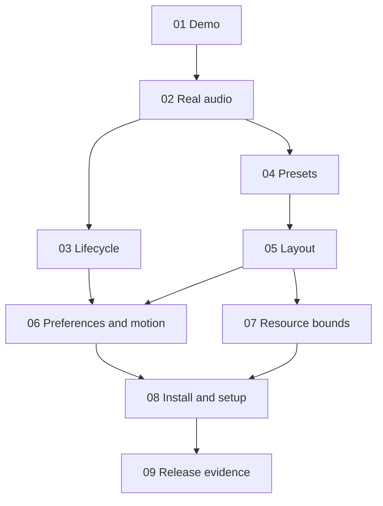

# PulseDeck published ticket breakdown

Version 0.2 | Approved and published to the local Markdown tracker

Each ticket delivers a complete behavior through the relevant input, controller, interface, and verification path. These are not separate frontend, backend, and test tasks. The configured local tracker contains one file per ticket at .scratch/pulsedeck/issues. Each file records demonstrated acceptance and remaining native release checks.

| Ticket | Title | Blocked by | What it delivers |
| --- | --- | --- | --- |
| 01 | Try a labeled spectrum demo | None | Open the plugin, start Demo, see spectrum, and stop it |
| 02 | Visualize real system audio | 01 | Start CAVA capture, display valid live frames, and stop |
| 03 | Recover and stop reliably | 02 | Handle errors, repeated controls, late frames, and exit cleanup |
| 04 | Switch among three live presets | 02 | Change between spectrum, ocean, and grid on the same source |
| 05 | Expand and resize the visualizer | 04 | Use compact and expanded layouts with capped dimensions |
| 06 | Remember preferences and reduce motion | 03, 05 | Persist safe settings, change source safely, and reduce animation |
| 07 | Keep resource use bounded | 05 | Drop stale frames and enforce parser, render, and diagnostic caps |
| 08 | Install and troubleshoot PulseDeck | 06, 07 | Installable package, host validation, and platform-specific setup |
| 09 | Verify real capture and release budgets | 08 | Evidence-backed compatibility, latency, cleanup, RAM, and CPU report |

Ticket 03 and ticket 04 become ready together after ticket 02. Ticket 06 and ticket 07 can proceed once their respective blockers finish. Edges deliberately omit redundant transitive dependencies.

## Approved breakdown and implementation batching

The user approved the scope and resumed engineering. Controller commands and source events observed through view state and resource ownership are the primary test seam. The nine tracer bullets retain their release prerequisites; three engineering batches implement core behavior, integration ports, and packaging while leaving unavailable native checks pending.

Tickets are published locally, one file per issue. No remote issues were created or parent issue changed. Native capture and zero-setup release remain blocked; local implementation is not represented as completed release acceptance.
